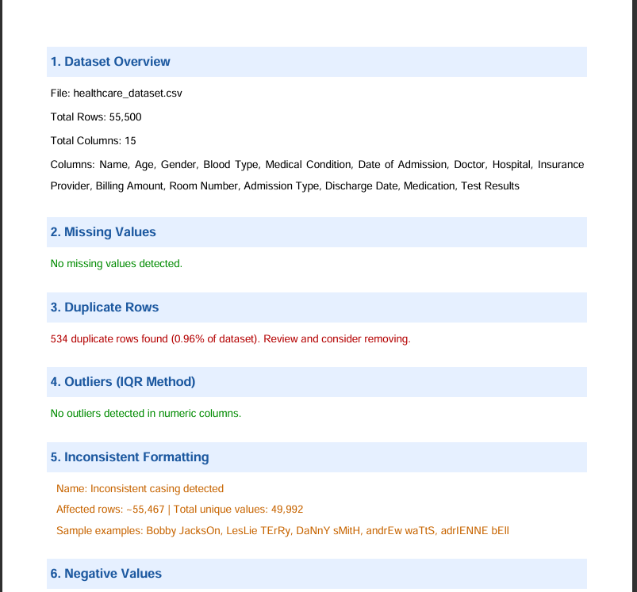

# Automated Data Quality Checker

## Overview
A Python tool that automatically analyzes any CSV dataset and 
generates a professional PDF report identifying data quality 
issues including missing values, duplicates, outliers, 
formatting inconsistencies, negative values, and invalid dates.

## Features
- Missing value detection with percentages
- Duplicate row identification
- Outlier detection using IQR method
- Inconsistent formatting / capitalization detection
- Negative value flagging
- Invalid date detection
- Overall data quality score (0–100)
- Professional PDF report output

## Tech Stack
Python, Pandas, NumPy, Matplotlib, FPDF2

## How to Run
pip install -r requirements.txt
python main.py

## Sample Output

## Use Cases
- Pre-processing validation for ML pipelines
- Healthcare data integrity checks
- Revenue cycle data auditing
- General ETL quality assurance