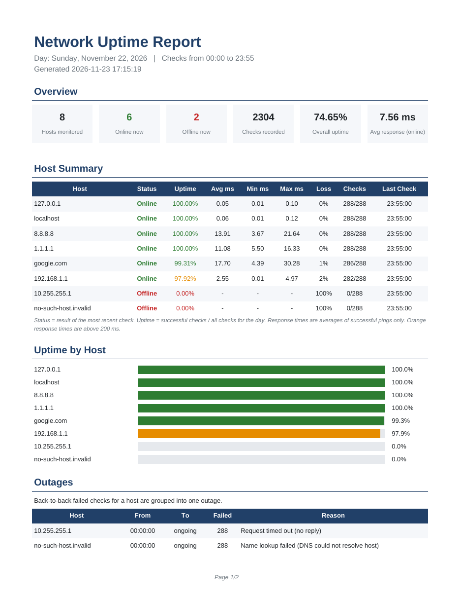

# Network Uptime Monitor

A small Python monitoring tool that pings a list of hosts, logs every result
to a local SQLite database, and produces a daily uptime report as a PDF and
CSV files.

It shows the full flow of a typical monitoring or reporting job:
**check hosts → structure the results → store them → summarize with pandas → report**,
with error handling at each step so one bad host never stops the run.



## Features

- Reads the list of hostnames and IP addresses to watch from `config.py`
- Pings every host and records whether it responded, its average response time in ms, packet loss, and a timestamp
- Pings hosts in parallel with a thread pool, so one slow or offline host does not delay the others
- Two ping methods: the `icmplib` library, or the operating system's own `ping` command through `subprocess` (chosen automatically)
- Logs every check to SQLite, plus an audit table (`monitor_runs`) of every monitor cycle
- Uses pandas to calculate uptime %, average / min / max response time, and outage periods per host
- Generates a formatted daily PDF report and CSV exports
- **Continuous mode**: re-checks every N minutes, appends to the database, and refreshes the day's report after each cycle
- Clear error messages for unreachable hosts, DNS failures, database errors, and report failures
- All settings live in one file: `config.py`

## Requirements

- Python 3.9 or newer
- Python packages listed in `requirements.txt`:
  - `icmplib` for pinging (optional: the system `ping` command is used if it is missing or not permitted)
  - `pandas` for data handling and summary statistics
  - `fpdf2` for PDF generation
  - `sqlite3` is built into Python, so nothing extra is needed

## Installation

```bash
git clone https://github.com/hfwolf4-sys/CodingProject.git
cd network-uptime-monitor

# Optional but recommended: create a virtual environment
python -m venv venv
source venv/bin/activate        # On Windows: venv\Scripts\activate

pip install -r requirements.txt
```

## How to Run

Run one full monitor cycle (ping, store, report) with one command:

```bash
python main.py
```

Optional flags:

| Command | What it does |
|---|---|
| `python main.py` | Pings every host once, saves the results, and builds today's report |
| `python main.py --continuous` | Checks every `CHECK_INTERVAL_MINUTES` (default 5) until you press Ctrl+C |
| `python main.py --continuous --interval 1` | Checks every minute |
| `python main.py --continuous --interval 1 --cycles 10` | Checks every minute and stops after 10 checks |
| `python main.py --report-only` | Skips pinging and rebuilds today's report from the database |
| `python main.py --report-only --date 2026-11-20` | Rebuilds the report for an earlier day |
| `python main.py --format csv` | Builds only CSV files for this run (`pdf`, `csv`, or `both`) |

The script exits with code `0` on success and `1` if the database or report
step fails. An offline host is a normal monitoring result, not a failure of
the script, so it still exits with `0`. This makes it easy to schedule a
single run every few minutes with cron or Windows Task Scheduler instead of
using continuous mode.

### A note on ping permissions

Sending ICMP (ping) packets directly needs special permission on some systems.
With `PING_METHOD = "auto"` the monitor handles this for you:

1. It tries `icmplib` in unprivileged mode (works on macOS and most Linux setups without admin rights).
2. If that is not allowed, it tries `icmplib` in privileged mode (works when run as admin/root).
3. If neither works, it falls back to running the system `ping` command, which works everywhere with no setup.

The method used is saved with every result in the `method` column.

## Configuration

Edit `config.py` to change what is monitored. Nothing is hardcoded in the other files.

| Setting | Purpose | Default |
|---|---|---|
| `HOSTS` | Hostnames or IP addresses to check | localhost, public DNS servers, google.com, and two deliberately unreachable examples |
| `PING_COUNT` | Echo requests sent to each host per check | 3 |
| `PING_TIMEOUT_SECONDS` | How long to wait for each reply | 2 |
| `PING_METHOD` | `auto`, `icmplib`, or `subprocess` | `auto` |
| `MAX_WORKERS` | How many hosts are pinged at the same time | 10 |
| `CHECK_INTERVAL_MINUTES` | Time between checks in continuous mode | 5 |
| `DATABASE_PATH` | SQLite file location | `data/uptime.db` |
| `OUTPUT_DIR`, `REPORT_FORMAT` | Where reports go and which format | `output/`, `both` |
| `SLOW_RESPONSE_MS` | Average response time flagged in orange in the PDF | 200 |

A host counts as **online** for a check if at least one of its echo requests gets a reply.

## Project Structure

```
network-uptime-monitor/
├── main.py           # Entry point: runs the monitor cycle (once or continuously) and handles failures
├── config.py         # All settings: host list, ping count, timeout, interval, file paths
├── pinger.py         # Pings hosts (icmplib or system ping) and returns structured PingResult objects
├── database.py       # Creates SQLite tables, saves results, logs runs, loads a day's data
├── report.py         # Uses pandas to summarize a day and writes the PDF and CSV reports
├── docs/             # Sample report used in this README
├── requirements.txt  # Python package dependencies
└── README.md
```

Created when the script runs (not committed to Git):

```
data/uptime.db        # SQLite database
output/               # Generated reports
```

### Database tables

**`ping_results`**: one row per host per check

| Column | Description |
|---|---|
| `run_id` | Which monitor cycle the check belongs to |
| `host` | Hostname or IP address |
| `timestamp` | When the check ran (local time, `YYYY-MM-DD HH:MM:SS`) |
| `is_up` | `1` if the host replied, `0` if not |
| `response_time_ms` | Average round trip time in ms (empty if offline) |
| `packets_sent`, `packets_received`, `packet_loss` | Raw ping counts and loss % |
| `method` | `icmplib` or `subprocess` |
| `error` | Why the host was offline, e.g. `Request timed out (no reply)` |

**`monitor_runs`**: one row per monitor cycle, with start and finish times,
hosts checked, hosts online, `SUCCESS`/`FAILED` status, and the error message
for failed cycles.

You can inspect the data with any SQLite tool, for example:

```bash
sqlite3 data/uptime.db "SELECT timestamp, host, is_up, response_time_ms FROM ping_results ORDER BY id DESC LIMIT 10;"
sqlite3 data/uptime.db "SELECT host, ROUND(AVG(is_up) * 100, 2) AS uptime_pct FROM ping_results GROUP BY host;"
```

## Example Output

Console output from a single run on a machine with internet access (response times will vary):

```
17:14:15  INFO     Database ready at data/uptime.db
17:14:15  INFO     Pinging 7 hosts (3 packets each, 2s timeout)...
17:14:17  INFO       127.0.0.1                ONLINE       0.06 ms   loss   0.0%
17:14:17  INFO       localhost                ONLINE       0.07 ms   loss   0.0%
17:14:17  INFO       8.8.8.8                  ONLINE      13.32 ms   loss   0.0%
17:14:17  INFO       1.1.1.1                  ONLINE      10.37 ms   loss   0.0%
17:14:17  INFO       google.com               ONLINE      13.35 ms   loss   0.0%
17:14:17  WARNING    10.255.255.1             OFFLINE  Request timed out (no reply)
17:14:17  WARNING    no-such-host.invalid     OFFLINE  Name lookup failed (DNS could not resolve host)
17:14:17  INFO     Saved 7 results to ping_results
17:14:17  INFO     5 of 7 hosts online
17:14:17  INFO     Report written: output/uptime_summary_2026-11-23.csv
17:14:17  INFO     Report written: output/uptime_checks_2026-11-23.csv
17:14:17  INFO     Report written: output/uptime_report_2026-11-23.pdf
17:14:17  INFO     Report covers 7 checks for 2026-11-23
```

Files written to `output/` (one set per day; later runs that day update them):

- **`uptime_report_<day>.pdf`**: the daily PDF report, which covers
  - a header with the day, the time range of the checks, and when the report was generated
  - **Overview**: hosts monitored, how many are online and offline right now, total checks, overall uptime, and average response time
  - **Host Summary**: a table with each host's **status (Online/Offline)**, **uptime % for the day**, **average response time**, min and max response time, packet loss, successful checks out of total, and the time of the last check. Status is color coded, and uptime and slow response times are highlighted
  - **Uptime by Host**: a bar chart of each host's uptime % (green at 99% or more, orange at 90% or more, red below)
  - **Outages**: back-to-back failed checks grouped into outage periods, with start and end time, number of failed checks, and the reason (timeout, DNS failure, unreachable)
- **`uptime_summary_<day>.csv`**: the Host Summary table, ready to open in Excel
- **`uptime_checks_<day>.csv`**: every individual check for the day

Example **Host Summary** from the sample report in [`docs/sample_report.pdf`](docs/sample_report.pdf)
(a full day of checks every 5 minutes; generated from sample data to show a realistic day):

| Host | Status | Uptime | Avg ms | Min ms | Max ms | Loss | Checks |
|---|---|---|---|---|---|---|---|
| 127.0.0.1 | Online | 100.00% | 0.05 | 0.01 | 0.10 | 0% | 288/288 |
| localhost | Online | 100.00% | 0.06 | 0.01 | 0.12 | 0% | 288/288 |
| 8.8.8.8 | Online | 100.00% | 13.91 | 3.67 | 21.64 | 0% | 288/288 |
| 1.1.1.1 | Online | 100.00% | 11.08 | 5.50 | 16.33 | 0% | 288/288 |
| google.com | Online | 99.31% | 17.70 | 4.39 | 30.28 | 1% | 286/288 |
| 192.168.1.1 | Online | 97.92% | 2.55 | 0.01 | 4.97 | 2% | 282/288 |
| 10.255.255.1 | Offline | 0.00% | - | - | - | 100% | 0/288 |
| no-such-host.invalid | Offline | 0.00% | - | - | - | 100% | 0/288 |

Example **Outages** section from the same report:

| Host | From | To | Failed | Reason |
|---|---|---|---|---|
| 10.255.255.1 | 00:00:00 | ongoing | 288 | Request timed out (no reply) |
| no-such-host.invalid | 00:00:00 | ongoing | 288 | Name lookup failed (DNS could not resolve host) |
| google.com | 03:20:00 | 03:20:00 | 1 | Request timed out (no reply) |
| 192.168.1.1 | 12:30:00 | 12:55:00 | 6 | Request timed out (no reply) |
| google.com | 16:45:00 | 16:45:00 | 1 | Request timed out (no reply) |

Example `uptime_summary_<day>.csv`:

```
Host,Status,Uptime (%),Avg Response (ms),Min Response (ms),Max Response (ms),Avg Packet Loss (%),Checks,Successful,Failed,First Check,Last Check,Last Error
127.0.0.1,Online,100.0,0.05,0.01,0.1,0.0,288,288,0,2026-11-22 00:00:00,2026-11-22 23:55:00,
192.168.1.1,Online,97.92,2.55,0.01,4.97,2.1,288,282,6,2026-11-22 00:00:00,2026-11-22 23:55:00,
10.255.255.1,Offline,0.0,,,,100.0,288,0,288,2026-11-22 00:00:00,2026-11-22 23:55:00,Request timed out (no reply)
```

## Error Handling

| Problem | What happens |
|---|---|
| Host does not reply | Recorded as Offline with `Request timed out (no reply)`; other hosts are unaffected |
| Hostname cannot be resolved (DNS) | Recorded as Offline with `Name lookup failed`; the run continues |
| No network route / destination unreachable | Recorded as Offline with the reason |
| No permission to send ICMP packets | Falls back from icmplib to the system `ping` command automatically |
| Unexpected error while pinging one host | Logged as a warning, recorded as Offline; the rest of the cycle continues |
| Database can't be opened or written | Clear error message and exit code `1`; inserts are rolled back so no partial cycle is saved |
| Report file can't be written (e.g. open in Excel) | Clear error message and exit code `1` |
| No data for the requested day | Report step explains that no results were found |
| A cycle fails in continuous mode | The error is logged and monitoring continues with the next cycle |

Every monitor cycle, successful or failed, is recorded in the `monitor_runs` table.

## Possible Extensions

- Send an email or Slack alert when a host goes offline or comes back
- Check TCP ports (e.g. 80/443) as well as ping, since some servers block ICMP
- Add a response time chart over the day with matplotlib
- Read the host list from a CSV or YAML file instead of `config.py`
- Add a weekly or monthly report that compares uptime across days
