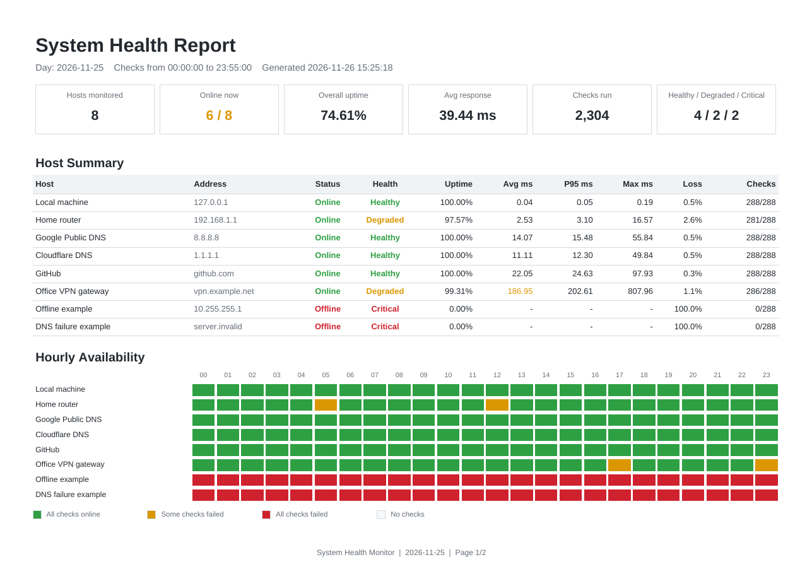

# System Health Monitor

A lightweight Python tool that checks whether a list of servers and devices
is reachable, logs every check to a SQLite database, and produces a daily
health report as a CSV and a PDF.

Each host gets a simple **Healthy / Degraded / Critical** rating for the day,
based on its uptime, response time, and packet loss, so problems stand out at
a glance instead of being buried in raw ping numbers.



## Why it is useful

Small teams, home labs, and IT support desks often need to know *"was
everything up today, and what was slow?"* without setting up a full
monitoring platform. This project answers that with one command and almost no
dependencies:

- **No ping library and no admin rights.** It runs the operating system's own
  `ping` command through `subprocess`, so it works the same way on Windows,
  macOS, and Linux.
- **A history you can query.** Every check is stored in SQLite, so you can
  answer questions later with plain SQL.
- **A report people can read.** The PDF is ready to send to a manager; the CSV
  opens straight in Excel.

It also shows the full flow of a typical operations or data job:
**collect → structure → store → summarize with pandas → report**, with error
handling at every step so one bad host or one failed write never crashes the run.

## Features

- Reads the host list (hostnames or IP addresses, with optional friendly labels) from `config.py`
- Pings each host and records whether it responded, response time in ms (avg, min, max), packet loss, and a timestamp
- Pings hosts in parallel, so one offline host does not slow down the rest
- Builds the right `ping` command for Windows, macOS, or Linux, and parses its output with regular expressions
- Explains why a host is offline: timeout, DNS lookup failure, destination unreachable, or ping not available
- Logs every result to SQLite, plus an audit table of every monitor cycle (`SUCCESS` or `FAILED`)
- Daily per-host summary calculated in SQL, extended with pandas (95th percentile response time, jitter, health rating, hour-by-hour availability)
- Generates a daily CSV summary, a CSV of every check, and a formatted PDF report
- `--continuous` mode re-checks every N minutes and refreshes the day's report after each cycle
- Logs to the console and to `logs/monitor.log`
- Every setting lives in one file: `config.py`

## Requirements

- Python 3.9 or newer
- The `ping` command (installed by default on Windows and macOS, and on almost every Linux system; on a minimal Linux image install `iputils-ping`)
- Python packages listed in `requirements.txt`:
  - `pandas` for summary statistics
  - `fpdf2` for PDF generation
  - `subprocess` and `sqlite3` are part of the Python standard library, so nothing extra is needed

## Installation

```bash
git clone https://github.com/hfwolf4-sys/CodingProject.git
cd CodingProject/system-health-monitor

# Optional but recommended: create a virtual environment
python -m venv venv
source venv/bin/activate        # On Windows: venv\Scripts\activate

pip install -r requirements.txt
```

## How to Run

Run one full monitor cycle (ping every host, save the results, build today's report):

```bash
python main.py
```

Keep monitoring and logging every N minutes:

```bash
python main.py --continuous                 # every CHECK_INTERVAL_MINUTES (default 5) until Ctrl+C
python main.py --continuous --interval 1    # every minute
python main.py --continuous --cycles 12     # stop after 12 cycles
```

Other options:

| Command | What it does |
|---|---|
| `python main.py --report-only` | Skips pinging and rebuilds today's report from the database |
| `python main.py --report-only --date 2026-11-25` | Rebuilds the report for an earlier day |
| `python demo_data.py` | Simulates a full day of checks in a separate demo database and builds a report from it in `output/demo/` (useful to see the report without waiting 24 hours) |

The script exits with code `0` on success and `1` if the database or report
step fails. An offline host is a normal monitoring result, not a script
failure, so it still exits with `0`. That makes it easy to schedule a single
run with cron or Windows Task Scheduler instead of using `--continuous`.

## Configuration

Everything is set in `config.py`; no other file needs editing.

| Setting | Purpose | Default |
|---|---|---|
| `HOSTS` | Hosts to check: plain strings, or `{"host": ..., "label": ...}` dicts | localhost, two public DNS servers, github.com, and two deliberately unreachable examples |
| `PING_COUNT` | Echo requests sent per host per check | 4 |
| `PING_TIMEOUT_SECONDS` | How long to wait for each reply | 2 |
| `MAX_PARALLEL_PINGS` | Hosts pinged at the same time | 8 |
| `CHECK_INTERVAL_MINUTES` | Time between cycles in `--continuous` mode | 5 |
| `HEALTHY_UPTIME_PCT` / `CRITICAL_UPTIME_PCT` | Uptime limits for the health rating | 99 / 90 |
| `SLOW_RESPONSE_MS` | Average response time that counts as slow | 150 |
| `MAX_PACKET_LOSS_PCT` | Average packet loss that counts as lossy | 5 |
| `DATABASE_PATH` | SQLite file | `data/health.db` |
| `OUTPUT_DIR` | Where reports are written | `output/` |
| `LOG_FILE` | Log file (`None` for console only) | `logs/monitor.log` |

A host is **online** for a check if at least one of its echo requests gets a reply.

## Project Structure

```
system-health-monitor/
├── main.py           # Entry point: runs the monitor cycle once or with --continuous
├── pinger.py         # Builds and runs the ping command, parses the output into PingResult objects
├── database.py       # Schema creation, inserts, and the daily summary queries
├── report.py         # pandas summary stats and the CSV and PDF report
├── config.py         # Host list and every setting
├── demo_data.py      # Builds a sample report from a simulated day
├── docs/             # Sample report and CSVs used in this README
├── requirements.txt
└── README.md
```

Created when the script runs (ignored by Git): `data/health.db`, `output/`, `logs/`.

### Database tables

**`ping_results`**: one row per host per check

| Column | Description |
|---|---|
| `run_id` | The monitor cycle the check belongs to |
| `host`, `label` | Hostname or IP address, and its friendly name |
| `timestamp` | When the check ran (local time) |
| `is_online` | `1` if the host replied, `0` if not |
| `avg_response_ms`, `min_response_ms`, `max_response_ms` | Round-trip times in ms (empty if offline) |
| `packets_sent`, `packets_received`, `packet_loss_pct` | Raw counts and loss % |
| `error` | Why the host was offline, e.g. `Request timed out (no reply)` |

**`monitor_runs`**: one row per cycle with start and finish time, hosts checked, hosts online, status, and error message.

Example queries:

```bash
sqlite3 data/health.db "SELECT timestamp, host, is_online, avg_response_ms FROM ping_results ORDER BY id DESC LIMIT 10;"
sqlite3 data/health.db "SELECT host, ROUND(AVG(is_online) * 100, 2) AS uptime_pct FROM ping_results GROUP BY host;"
```

## The PDF Report

`output/health_report_<day>.pdf` (A4 landscape) contains:

1. **Header**: the day, the time range of the checks, and when the report was generated.
2. **Overview tiles**: hosts monitored, how many are online right now, overall uptime, average response time, total checks, and the count of Healthy / Degraded / Critical hosts.
3. **Host Summary table**: for each host, its **status (Online/Offline)** at the last check, its **health rating**, **uptime % for the day**, **average response time**, 95th percentile and maximum response time, packet loss, and successful checks out of total. Status and health are color coded, and slow averages are highlighted.
4. **Hourly Availability grid**: one row per host and one cell per hour of the day, colored green (all checks online), amber (some failed), or red (all failed), so you can see *when* problems happened.
5. **Issues**: every host that is not Healthy, with the reason (for example "Slow (187 ms avg)" or "Uptime 97.6%") and its last error message.
6. **Health rules**: a short note explaining how the ratings are calculated.

The run also writes two CSV files:

- `health_summary_<day>.csv`: the per-host summary (one row per host)
- `health_checks_<day>.csv`: every individual check for the day

Each run on the same day refreshes these files with all of that day's data so far.

## Sample Output

Real console output from `python main.py`. This run was on a cloud machine whose
firewall blocks outgoing ping, so the public hosts show as unreachable, which also
shows how failures are reported without stopping the run (on a normal
internet connection they come back online with response times in ms):

```
15:25:11  INFO     Database ready at data/health.db
15:25:11  INFO     Pinging 7 hosts (4 packets each, 2s timeout)...
15:25:16  INFO       127.0.0.1                ONLINE       0.04 ms   loss   0.0%
15:25:16  INFO       localhost                ONLINE       0.02 ms   loss   0.0%
15:25:16  WARNING    8.8.8.8                  OFFLINE  Destination unreachable
15:25:16  WARNING    1.1.1.1                  OFFLINE  Destination unreachable
15:25:16  WARNING    github.com               OFFLINE  Destination unreachable
15:25:16  WARNING    10.255.255.1             OFFLINE  Destination unreachable
15:25:16  WARNING    server.invalid           OFFLINE  DNS lookup failed (host name could not be resolved)
15:25:16  INFO     Saved 7 results. 2 of 7 hosts online.
15:25:16  INFO     Report written: output/health_summary_2026-11-26.csv
15:25:16  INFO     Report written: output/health_checks_2026-11-26.csv
15:25:16  INFO     Report written: output/health_report_2026-11-26.pdf
```

The sample report in [`docs/sample_report.pdf`](docs/sample_report.pdf) was
built with `python demo_data.py --date 2026-11-25`, which simulates a full day
of checks every 5 minutes (including a 30-minute router outage and a slow VPN
link) and then runs the normal report code. Its host summary:

| Host | Status | Health | Uptime | Avg ms | P95 ms | Loss | Checks |
|---|---|---|---|---|---|---|---|
| Local machine (127.0.0.1) | Online | Healthy | 100.00% | 0.04 | 0.05 | 0.5% | 288/288 |
| Home router (192.168.1.1) | Online | Degraded | 97.57% | 2.53 | 3.10 | 2.6% | 281/288 |
| Google Public DNS (8.8.8.8) | Online | Healthy | 100.00% | 14.07 | 15.48 | 0.5% | 288/288 |
| Cloudflare DNS (1.1.1.1) | Online | Healthy | 100.00% | 11.11 | 12.30 | 0.5% | 288/288 |
| GitHub (github.com) | Online | Healthy | 100.00% | 22.05 | 24.63 | 0.3% | 288/288 |
| Office VPN gateway (vpn.example.net) | Online | Degraded | 99.31% | 186.95 | 202.61 | 1.1% | 286/288 |
| Offline example (10.255.255.1) | Offline | Critical | 0.00% | - | - | 100.0% | 0/288 |
| DNS failure example (server.invalid) | Offline | Critical | 0.00% | - | - | 100.0% | 0/288 |

The matching CSV files are in `docs/`:
[`sample_summary.csv`](docs/sample_summary.csv) (full summary) and
[`sample_checks_excerpt.csv`](docs/sample_checks_excerpt.csv) (the first checks of the day). For example:

```
Host,Label,Status,Health,Health Notes,Uptime (%),Avg Response (ms),...,Last Error
192.168.1.1,Home router,Online,Degraded,Uptime 97.6%,97.57,2.53,...,
vpn.example.net,Office VPN gateway,Online,Degraded,Slow (187 ms avg),99.31,186.95,...,
10.255.255.1,Offline example,Offline,Critical,Uptime 0.0% is below 90%,0.0,,...,Request timed out (no reply)
```

## Error Handling

| Problem | What happens |
|---|---|
| Host does not reply | Recorded as Offline with `Request timed out (no reply)`; other hosts are unaffected |
| Hostname cannot be resolved | Recorded as Offline with `DNS lookup failed` |
| Destination or network unreachable | Recorded as Offline with `Destination unreachable` |
| `ping` missing, blocked, or hangs | Recorded as Offline with the reason; a hard time limit stops a stuck ping process |
| Blank, duplicate, or malformed host entries | Skipped when the host list is read |
| Database cannot be opened or written | Clear error, exit code `1`; inserts are rolled back so no half-saved cycle; the cycle is marked `FAILED` in `monitor_runs` when possible |
| Report file cannot be written (for example, open in Excel) | Clear error, exit code `1` |
| No data for the requested day | Warns that no report was written |
| A cycle fails in `--continuous` mode | The error is logged and monitoring carries on with the next cycle |

## Possible Extensions

- Email or Slack alerts when a host's health changes
- TCP port checks (for example 443) for servers that block ping
- A weekly report comparing health across days
- A small web dashboard reading from the same SQLite database
